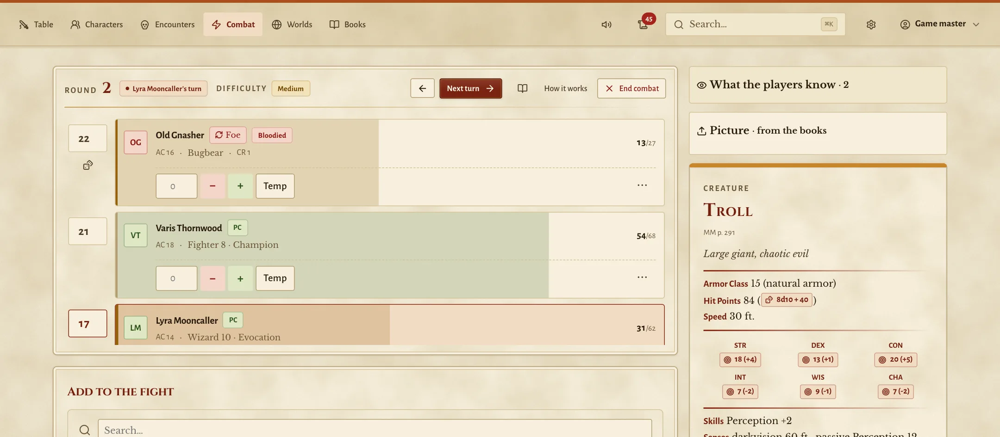

# Paravent

**The game master's screen in your browser**, for Dungeons & Dragons 5e at a real table.
Paravent keeps the numbers, notes and handouts in order; the dice, the voices and the story
stay at the table. It runs on your own machine and your home network, with no cloud and
no account. [paravent.org](https://paravent.org) shows it in pictures.

<picture>
  <source media="(prefers-color-scheme: dark)" srcset="website/assets/img/screens/en/dark/combat.webp">
  
</picture>

- **For the game master:** a combat tracker that never decides for you, encounters rated
  for the party you have, adventures written as plain Markdown, handouts, a sound desk,
  names for every people of your world, and a recap of the evening.
- **For the players:** their character sheet on the phone, their own dice, the fight from
  their side, and a journal of what you handed them.
- **Your books, your rules:** each world declares which books it uses, both the 2014 and
  the 2024 rules work, the whole interface speaks English and German.
- **No content included:** Paravent ships no rulebook text. It reads rules data in the
  5eTools format that you bring, in place, and never changes it (see [Data](#data)).

## Quick start

```bash
git clone https://github.com/afhrad/paravent.git && cd paravent
uv venv && uv pip install -e ".[dev]"
cp .env.example .env      # point PARAVENT_REFERENCE_DIR at your 5eTools data, or empty it
./run.sh --lan            # open http://localhost:8000, the first visit creates the game master
```

Then *Table* → **Getting started** walks you to your first fight. On a NAS or server, see
[Docker](#docker-nas); to work on Paravent itself, [CONTRIBUTING.md](CONTRIBUTING.md). MIT
licensed (see [Licence and notices](#licence-and-notices)).

## Documentation

All specs live in [`documentation/`](documentation/). `CLAUDE.md` stays at the root
because the agent loads it from there.

| Document | Covers |
| --- | --- |
| [SETUP.md](documentation/SETUP.md) | Getting it running, the short way |
| [PROJECT.md](documentation/PROJECT.md) | Scope and features |
| [TECHSTACK.md](documentation/TECHSTACK.md) | Stack decisions, the two data roots, corpus coverage, reference resolution |
| [DESIGN.md](documentation/DESIGN.md) | UI spec — tokens, components, the tag renderer, tooltips |
| [THEMES.md](documentation/THEMES.md) | Exchangeable looks, and the Tome theme |
| [ADVENTURES.md](documentation/ADVENTURES.md) | Worlds, adventures, chapters and Paravent's Markdown |
| [CHARGEN.md](documentation/CHARGEN.md) | What the dataset supports for character creation, and the gaps |
| [CHARGEN-WIZARD.md](documentation/CHARGEN-WIZARD.md) | The creation wizard's UX, step by step, and levelling up |
| [CHARACTER-FORMAT.md](documentation/CHARACTER-FORMAT.md) | The character file, its overrides and live updates |
| [COMBAT.md](documentation/COMBAT.md) | The combat tracker's rules and screens |
| [RUNNING-A-FIGHT.md](documentation/RUNNING-A-FIGHT.md) | A gamemaster's walkthrough of a fight, turn by turn |
| [PROTOCOL.md](documentation/PROTOCOL.md) | The log of rolls and events, and its toasts |
| [PLAYER-VIEW.md](documentation/PLAYER-VIEW.md) | What players may read |
| [JOURNAL.md](documentation/JOURNAL.md) | Handouts and the players' journal |
| [SOUND.md](documentation/SOUND.md) | The sound desk and the speaker page |
| [NAMES.md](documentation/NAMES.md) | Naming styles and the name generator |
| [TRANSLATION.md](documentation/TRANSLATION.md) | Multilingual design — overlays, glossary, units |
| [MCP.md](documentation/MCP.md) | Claude as co-author over MCP |
| [PROGRESS.md](documentation/PROGRESS.md) | What is built, what is next |

Visual reference: [`design-reference/`](design-reference/) — 17 standalone pages, openable
straight from the filesystem, including clickable character-creation demos.

## Data

Paravent keeps data in **two roots with different rules**, and the distinction is the
foundation everything else rests on:

| Root | What | Written by the app |
| --- | --- | --- |
| **reference** | The 5eTools corpus you bring | **Never.** Read-only. |
| **`data/library/`** | Everything you make with Paravent | Constantly. **Back this up.** |

Delete and re-import the corpus whenever you like — `library/` is untouched by it.

### Reference: the 5eTools corpus

**Paravent ships no 5e content.** The tool provides the load mechanism; you bring the
data. See TECHSTACK.md §8 for the reasoning.

The corpus is **not copied into the project** — it is read in place from wherever you keep
it. Copy `.env.example` to `.env` and set `PARAVENT_REFERENCE_DIR`, either to a whole
5eTools release (`data/5etools-v2.39.0`, whose corpus is its `data/` folder) or to the
corpus folder itself. The expected layout is the 5eTools one, unmodified:

```text
<reference dir>/
├── bestiary/     bestiary-*.json + fluff-bestiary-*.json
├── spells/       spells-*.json + fluff-spells-*.json
├── class/        class-*.json (class, subclass, and their features)
├── book/         long-form rulebook text
├── adventure/    published adventure text
├── generated/    gendata-* lookup tables
└── *.json        items, races, feats, backgrounds, … (63 root files)
```

**Pictures** (optional): 5eTools ships its images apart from the data. Paravent looks
in `PARAVENT_IMAGE_DIR`:

```text
data/
├── 5etools-v2.39.0/        PARAVENT_REFERENCE_DIR=data/5etools-v2.39.0
└── 5etools-img-v2.39.0/    PARAVENT_IMAGE_DIR=data/5etools-img-v2.39.0
    ├── bestiary/
    │   └── MM/
    │       └── Goblin.webp
    └── book/ …
```

The image folder must start with `bestiary/`, `book/` and so on — if a download unpacks one
level deeper (`img/bestiary/…`), point at the inner folder. Check: the file
`bestiary/MM/Goblin.webp` exists in it. Without the setting Paravent looks for a folder
called `img` next to the corpus folder. Like the corpus the images are read in place, never
written, and `data/5etools*/` is ignored by git.

Players then see a creature's picture in its Details on the fight view; without the
folder they see the description alone.

Nothing is written back there. Anything Paravent derives from the corpus goes to
`data/reference-cache/`, which is disposable and rebuilt on demand.

### Library: your own content

Worlds, adventures, encounters, characters, combat state, users and sessions live as one
JSON file per collection under `data/library/`, keyed by record id. Media goes in
`data/library/media/`.

Translations live here too — `data/library/i18n/` — because a translation is authored content.
They are text-only overlays on the English records, so they never affect mechanics and deleting
them always falls back cleanly to English. See [TRANSLATION.md](documentation/TRANSLATION.md).

Homebrew belongs here too — `data/library/homebrew/`. It uses the 5eTools *format* so it
shares the compendium keyspace and can be a `_copy` target, but it is your work, so it sits
on the backed-up side of the line. It loads after the corpus, so an entry with the same
`name` and `source` overrides an imported one.

### Backups

Paravent backs the library up by itself — the library only: the 5eTools corpus is a
replaceable download and the reference cache is rebuilt on demand. Set in `.env`:

```bash
PARAVENT_BACKUP_DIR=/volume1/backup/paravent   # where the zip files go; empty: off
PARAVENT_BACKUP_AT=03:00                        # local times of day, e.g. 03:00,15:00
PARAVENT_BACKUP_KEEP=14                         # the oldest beyond this are deleted
```

Each backup is `paravent-library-<date>_<time>.zip`, written complete or not at all, with
a `paravent-backup.json` manifest. A scheduled run is skipped when nothing in the library
changed since the last one. `python -m app.cli backup run` makes one now (`--if-changed`
to skip an unchanged library), `backup list` shows those kept. The folder must not lie
inside the library or the corpus; Paravent refuses to start a backup there.

A backup holds the password hashes and the session signing key (`.secret_key`), so the
files are readable by their owner only — keep the folder private, or copy it somewhere
that is. **To restore:** stop Paravent, unzip into an empty library folder (leaving out
`paravent-backup.json`), and start it again.

## Setup

[documentation/SETUP.md](documentation/SETUP.md) is the shortest way to a running table.

```bash
uv venv
uv pip install -e ".[dev]"
cp .env.example .env      # then point PARAVENT_REFERENCE_DIR at your corpus
```

## Version

The server's version is set in one place: `version` in `pyproject.toml` (major.minor.patch,
from 0.1.0). The app reads it from that file at start (`app/__init__.py`); the Docker image
carries the file for that.

**Every commit raises the patch number** (0.1.4 → 0.1.5): the pre-commit hook in
`scripts/hooks/` changes the version line in `pyproject.toml` and `uv.lock` and puts that
into the same commit. Enable it once per clone:

```bash
git config core.hooksPath scripts/hooks
```

A commit that changes the version itself (raising minor or major by hand) is left as it
is; `PARAVENT_NO_BUMP=1 git commit …` skips the bump once.
It shows at the bottom of the user menu and on the login page ("Paravent 0.1.0"), so you can
tell at a glance which build a device is talking to.

## Running

```bash
./run.sh                 # http://localhost:8000, auto-reload
./run.sh --lan           # also reachable from the iPad/phone on the LAN
./run.sh --port 9000     # a different port
./run.sh --prod          # no auto-reload
./run.sh --help
```

Any other argument is passed through to uvicorn (`./run.sh --log-level warning`).
The script uses the venv's uvicorn, warns when `.env` is missing, and reports the
owning PID if the port is already taken instead of failing on the bind. A reload waits at
most 3 seconds for open live pages (`--timeout-graceful-shutdown`); they reconnect by
themselves.

Every log line has the same layout, Paravent's and uvicorn's alike: time, level, source,
message (`app/logs.py`, `app/log_config.json`, which `run.sh` and the Docker image pass to
uvicorn with `--log-config`). In a terminal the level and source are coloured; `NO_COLOR=1`
turns that off, `FORCE_COLOR=1` on, for example when piping into a pager.

Equivalent by hand:

```bash
.venv/bin/uvicorn app.main:app --reload            # http://localhost:8000
.venv/bin/uvicorn app.main:app --host 0.0.0.0      # LAN
```

`GET /health` reports how many entries loaded. `GET /api/compendium/status` reports
anything the load rejected.

## Docker (NAS)

The image holds only the code. The corpus and your content come in as volumes:

| In the container | Mount | Mode |
| --- | --- | --- |
| `/data/reference` | your 5eTools corpus (`PARAVENT_REFERENCE_DIR`) | **read-only** |
| `/data/img` | the 5eTools images (`PARAVENT_IMAGE_DIR`) | **read-only** |
| `/data/library` | everything made with Paravent (`PARAVENT_LIBRARY_DIR`) | read-write — **back this up** |
| `/data/reference-cache` | named volume `paravent-cache` | disposable |
| `/data/backups` | your backup folder (`PARAVENT_BACKUP_DIR`) | read-write — see [Backups](#backups) |

Set the paths in a `.env` next to `docker-compose.yaml` (or in the NAS's compose UI):

```bash
PARAVENT_REFERENCE_DIR=/volume1/docker/paravent/5etools-data
PARAVENT_LIBRARY_DIR=/volume1/docker/paravent/library
PUID=1026              # owner of the library folder (`id <user>`)
PGID=100
PARAVENT_PORT=8000     # the port on the NAS
```

```bash
docker compose up -d --build                                   # then open http://<nas>:8000/setup
docker compose exec paravent python -m app.cli user add        # accounts from the shell
```

The container must be able to **create files** in the library folder, not only read
them — every save writes a temporary file beside its target. If `PUID:PGID` is not the
folder's owner, logins fail with `PermissionError … .sessions.json.tmp`, and the log says
so at start. Fix it with `sudo chown -R 1026:100 /volume1/docker/paravent/library` (your
`PUID:PGID`) or by setting `PUID`/`PGID` to the folder's current owner.

The other settings in `docker-compose.yaml` — `PARAVENT_SECRET_KEY`,
`PARAVENT_COOKIE_SECURE` (only behind HTTPS), `WATCHFILES_FORCE_POLLING` (library on a
network share), `FORWARDED_ALLOW_IPS` (behind a reverse proxy) — have working defaults.
Build on the NAS itself, or with `docker buildx build --platform linux/amd64` when the NAS
is Intel/AMD and the build machine an Apple Silicon Mac.

### Machine translation (optional)

Paravent can draft translations of the corpus text — spells, creatures, items, rules,
rulebook chapters, adventure sections — through the **Claude API** (Anthropic). It is off
until a key is set, because it sends English corpus text to an external service and costs
money per passage. Translating by hand in the editor works without it. Design and rules:
[documentation/TRANSLATION.md](documentation/TRANSLATION.md) §7.

**Enable it**

1. Create an API key at [console.anthropic.com](https://console.anthropic.com): add a
   payment method under *Billing*, then create a key under *API Keys* (`sk-ant-…`). API
   usage is billed per token, separately from any Claude subscription.
2. Add it to the `.env` next to `docker-compose.yaml` on the server:

   ```bash
   PARAVENT_TRANSLATE_API_KEY=sk-ant-...
   # optional, see the table below:
   PARAVENT_TRANSLATE_MODEL=claude-opus-5-5
   ```

3. Restart with `docker compose up -d`. Keep the key in the server's `.env` only; it is
   never part of the image or the repository.

**Use it**

- *One record*: on a reference page, rulebook chapter or adventure section, "Translate the
  text" → "Machine-translate the rest". Only passages without a translation are sent; your
  own translations are never overwritten.
- *Many at once*: settings gear → *Translations*: the 25 or 100 most-linked untranslated
  entries, a whole rulebook or a whole adventure. Runs in the background with progress.
- Every machine translation is a **draft**, marked "Machine translation, not yet reviewed"
  until confirmed in the editor ("Reviewed" per passage, or "Confirm all drafts").
- *Glossary names*: settings gear → *Glossary* → "… names still to give" → "Get
  suggestions" asks for German names for every open (`"-"`) entry in view, 150 a request,
  in the background. A suggestion shows under its field and counts only once saved: take
  one, or "Take all suggestions on this page". Only names, their book and a sample of your
  own names for the same kind are sent.

**What it sends, and the safeguards**

- English text passages, plus the glossary's names for terms they mention, so names come
  back consistent ("Feuerball", "Liegend").
- `{@…}` tags must come back unchanged; a passage whose tags differ is discarded and stays
  English.
- A request Claude declines is re-run on the fallback model Anthropic recommends; API errors
  leave the text unchanged and are counted on the progress line.

**Model and cost**

The default is Claude Opus 5.5 at low reasoning effort (`PARAVENT_TRANSLATE_EFFORT=low`).
Prices per million tokens, input / output, as of October 2026:

| Model | `PARAVENT_TRANSLATE_MODEL` | Price |
| --- | --- | --- |
| Claude Opus 5.5 (default, best quality) | `claude-opus-5-5` | $4 / $20 |
| Claude Sonnet 5.5 | `claude-sonnet-5-5` | $2 / $10 |
| Claude Haiku 4.5 (cheapest) | `claude-haiku-4-5` | $1 / $5 |

A rough guide, not a measurement: one spell costs well under a cent; a book the size of the
Player's Handbook in the order of $10 with Opus, about half that with Sonnet. German runs
longer than English, so output tokens dominate. Start with the 25 most-linked entries and
check the usage in the Anthropic console before translating whole books.

### A translated corpus (optional)

A corpus in another language, in the 5eTools format, imports as translations over the
English one (TRANSLATION.md §7): entries, descriptions, rulebook chapters and adventure
sections, passage by passage, kept only where their links match the English.

```bash
python -m app.cli translations import /path/to/5etools-de de --dry-run   # what it would do
python -m app.cli translations import /path/to/5etools-de de             # as drafts
```

Imported passages are drafts until confirmed (*Translations* → *Drafts to review*), or
reviewed at once with `--reviewed`. Your own translations are kept unless `--replace`.
The same import runs from the app: settings gear → *Translations* → *Import a translated
corpus*, with a folder on the server, **Check first** and **Import**.

### Updating the server from this machine

`./sync-server.sh` sends the code over ssh/rsync, rebuilds the image on the server,
restarts the container and waits until `/health` answers. Tell it where the server is in
a `sync.env` (gitignored) next to the script:

```bash
PARAVENT_SYNC_HOST=user@server      # ssh destination; an alias from ~/.ssh/config works
PARAVENT_SYNC_DIR=/srv/paravent     # the folder holding docker-compose.yaml there
```

```bash
./sync-server.sh --dry-run          # what would be sent
./sync-server.sh                    # code only — the usual update
./sync-server.sh --corpus           # also the corpus and images your .env points at
./sync-server.sh --library          # also data/library, see below
```

The server's own `.env` is never sent. `--library` stops the container, writes a backup
to `backups/library-<time>.tar.gz` on the server, then sends only files that are newer
here: a character played on the server since is kept, and nothing there is deleted. The
corpus and library folders are taken from the running container's mounts.

## Licence and notices

Paravent is released under the [MIT License](LICENSE): use it, change it and pass it on,
as long as the copyright and permission notice stays with it.

That licence covers Paravent's own code and texts. Paravent ships no rulebook content; you
bring the data (above, "Data"). What the repository does contain from others, and under
which terms, is in [`NOTICE.md`](NOTICE.md): short passages of the System Reference
Documents 5.1 and 5.2.1 by Wizards of the Coast LLC (Creative Commons Attribution 4.0), the
Lucide icons (ISC), the Tome theme's fonts (SIL Open Font License), htmx (Zero-Clause BSD)
and the 5eTools tag syntax (MIT).

Paravent is not affiliated with, endorsed or sponsored by Wizards of the Coast or the 5eTools
project.

## Development

How to set up, test and send a change, and what may not go into the repository:
[CONTRIBUTING.md](CONTRIBUTING.md).

```bash
pytest                    # the whole suite
pytest -n auto            # the same, on every core (about 2½ minutes)
pytest --cov=app          # coverage
ruff check . && ruff format .
mypy app/
```

Tests that need the 5eTools corpus are skipped when it is absent, so the suite passes on
a clean checkout. Set `PARAVENT_TEST_CORPUS` to run them against your data.

### Three things worth knowing before changing the data layer

**Reference is read-only, and that is enforced, not merely intended.** `StoreRegistry`
refuses to start if a writable root lies inside the corpus, so pointing the library at a
subdirectory of your 5eTools data fails loudly instead of putting your campaign where the
next re-import would erase it. If something needs writing, it belongs in `library/` (user
content) or `reference-cache/` (disposable derived artefacts).

**`_copy` is not optional.** 1,144 bestiary entries and 53 items are patches against another
entry, not records. Unresolved, they render as blank statblocks. Resolution runs at load,
before validation, because a shell often lacks fields the model requires.

**Compendium models are lossless, library models are strict.** The imported schema is wide,
sparse and someone else's — it grows with every published book, so unknown fields are
preserved. The library schema is ours, so an unknown field there is a bug and is rejected.

## Architecture

```text
app/
├── main.py           FastAPI entry point, lifespan, exception handlers
├── config.py         pydantic-settings, PARAVENT_-prefixed env vars
├── dependencies.py   DI providers — routes never touch a global
├── models/
│   ├── base.py       lossless base model; strips 5eTools' explicit-null deletions
│   ├── values.py     the polymorphic field types (ac, cr, hp, speed, type)
│   ├── compendium.py the imported categories
│   └── gamestate.py  our own strict schemas, incl. the 5e combat rules
├── store/
│   ├── jsonfile.py   atomic writes, per-path locking
│   ├── copyresolver.py  `_copy` inheritance — 25% of the bestiary depends on it
│   ├── compendium.py in-memory, searchable; reads the reference root
│   ├── gamestate.py  CRUD collections under library/, persisted per mutation
│   ├── watcher.py    reload on any JSON change
│   └── registry.py   store lifecycle
└── routes/           thin — logic lives in services/
```
